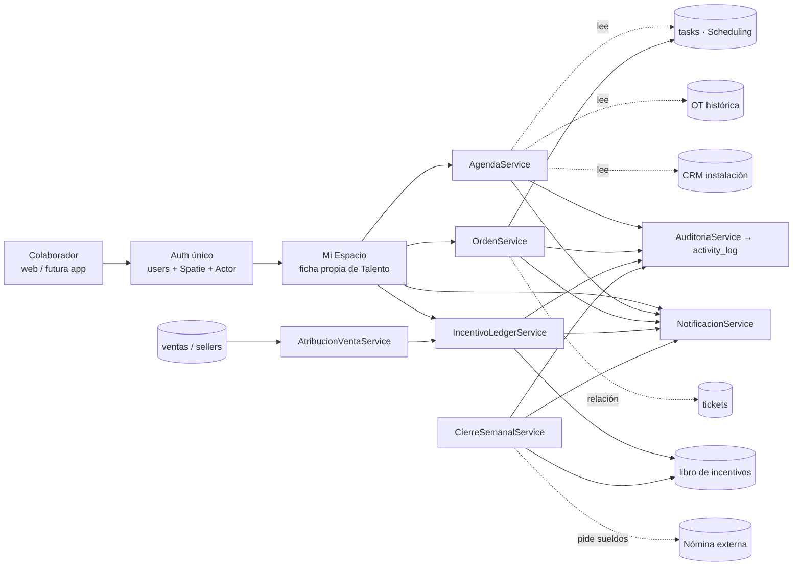
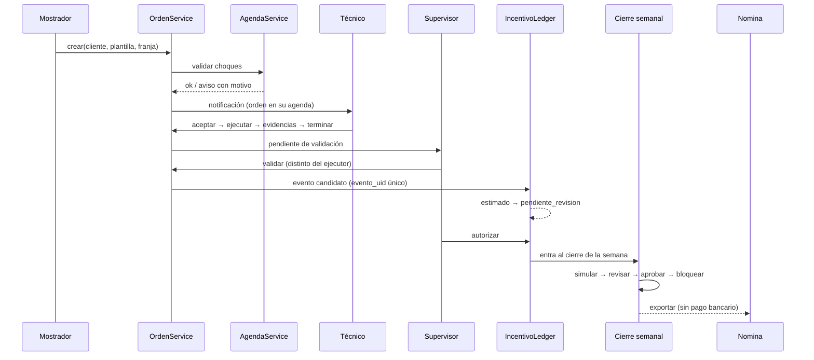
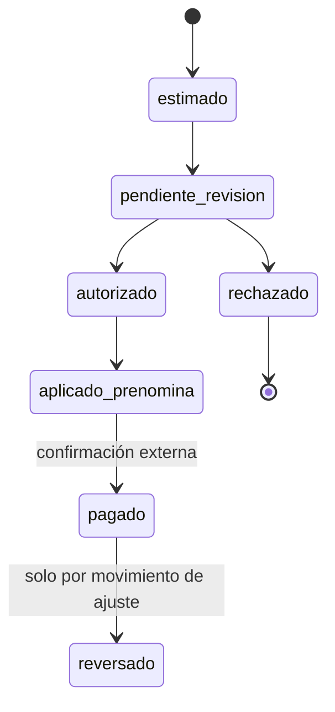

# UNI-02 · Documento 2 del plan maestro: arquitectura propuesta y dueño de cada dato

Item #686 · épica UNI · 2026-10-24 · **solo diseño**: sin cambios de código, migraciones, permisos, config ni `.env`.
Base: auditorías `01a`–`01e` de esta carpeta (evidencia `archivo:línea` y conteos viven ahí; aquí se citan por documento y sección). Conteos = BD de dev. Nada se verificó en producción.
Sin nombres de personas, contactos ni montos por persona: solo nombres técnicos y conteos.

> **Actualizado tras #691–#694 y #697–#699 (2026-10-26):** la **fuente oficial de fecha** de una tarea/orden es `start_date` (Y-m-d) + `start_time`/`end_time` datetime, leída con `TaskScheduleService` (#691); la **autorización** de lectura/edición de tareas por id y calendario es «asignado, supervisor o admin» (#692/#698); los **tokens** de la app de Talento vencen y el login tiene límite de intentos (#693). Cierres parciales: los datos históricos de fecha no se reescribieron (comando `tasks:conciliar-fechas` solo con `--dry-run`) y el endurecimiento de la API móvil más allá de #693 sigue en «Preguntas para Irving» (01e P6).

## 1. Principios y lo que NO cambia

Prioridades del contrato (§20) aplicadas como reglas de diseño:

| # | Regla de diseño | Consecuencia concreta |
|---|---|---|
| 1, 11 | No perder información, respetar histórico | Ninguna tabla existente se borra ni se reescribe; lo histórico queda de solo lectura (OT históricas, `commissions_details`, liquidaciones) |
| 2, 3 | No interrumpir, reutilizar | Cada módulo sigue escribiendo su dato; la capa nueva **lee** y **orquesta** |
| 4 | Una identidad | `users` es la cuenta; ninguna tabla nueva de personas |
| 10, 12 | Indicadores en Talento; automatizar sin quitar supervisión | Talento calcula, un humano autoriza, otro sistema paga |
| 13, 14 | Backend reutilizable, seguridad y auditoría | Servicios de negocio únicos; web y móvil los llaman igual |

**No cambia** (se conserva tal cual): guard `web` y login por `login_user`; Spatie + `CheckRoutePermission`; `Actor` como identidad por request; `PayWeek` (Sáb 18:00→Sáb 18:00) y `LiquidationService::countBillableUnits` como punto único del conteo; `tasks` + `talento_type_id` como orden de campo vigente; las reglas económicas actuales (01a §5, 01c §4). Ninguna regla de pago se modifica en esta etapa.

## 2. Mapa de dueños

Convención: **dueño** = único módulo que escribe la fila oficial. «Lee» = consume sin copiar. «Nuevo» = no existe hoy y se propone.

| Entidad | Módulo dueño | Tabla oficial | Lee | Escribe | Estado hoy (fuente) |
|---|---|---|---|---|---|
| Cuenta | Core/Auth | `users` (4,981; 1 de sistema) | todos | Administración | Funciona (01e §2.1) |
| Persona / colaborador | Talento | `talento_colaboradores` (39, `user_id` UNIQUE) | todos vía `Actor` | Talento | Funciona (01a §2) |
| Vendedor (rol comercial) | Vendedores | `sellers` (32) → se vuelve **capacidad** del colaborador, no persona aparte | Talento, CRM, Clientes | Vendedores | Duplicado con colaborador (01e §8 #3) |
| Rol de seguridad | Core/Auth | `roles`/`permissions` (Spatie) | middleware | Administración | Funciona |
| Puesto | Core/Auth (= rol) | rol Spatie, sin tabla propia | Talento | Administración | Decisión 2026-10-21 (01e §3.2) |
| Departamento | Talento | **Nuevo** `talento_departamentos` (hoy: texto libre y `role_departments`) | Agenda, Cierre | Talento | Incompleto |
| Capacidad profesional | Talento | **Nuevo** `talento_capacidades` + pivote (puede vender, puede validar, técnico PI/PE…) | Agenda, Órdenes, Ventas | Talento | No existe |
| Cuadrilla / equipo | Talento | **Nuevo** `talento_cuadrillas` + miembros; `supervisor_id` sigue para el árbol | Agenda, Órdenes | Talento | No existe (01a §6) |
| Tarea | Scheduling | `tasks` (1,666) + `task_user` | Agenda, Talento | Scheduling | Funciona; fechas `varchar` (01b §2) |
| Ticket | Tickets | `tickets` (899) | Mostrador, Agenda (vía tarea) | Tickets | Sin fecha, sin llave a orden (01d §2) |
| Orden de trabajo | Scheduling (`tasks` con `talento_type_id`) | `tasks` | Talento, Agenda, Seguimiento | `TalentoWorkOrderController::store` / servicio de órdenes | Vigente; OT histórica aparte |
| OT histórica | Talento | `talento_work_orders` (208) | Agenda (solo lectura), Pago | **nadie** (congelada) | Histórico (01d §1) |
| Instalación (alta comercial) | Cobranza/Instalaciones | `cut_installations` (175) | Calidad, Talento | su módulo | Sin llave a orden (01d §2) |
| Garantía (evento) | Talento | **Nuevo** `talento_garantia_eventos` (hoy: `responsibility_windows` en 0 y `warranty_overrides` en 0) | Calidad, Tickets | Talento | Incompleto (01d §7) |
| Actividad de agenda | **cada fuente** | no hay tabla: índice de lectura | Mi Espacio, supervisión | la fuente | Falta (01b §1) |
| Recordatorio / reprogramación / participante extra | Agenda (servicio) | **Nuevo** tablas auxiliares pequeñas | Notificaciones | `AgendaService` | No existe |
| Venta | Vendedores / Clientes | atribución en `client_main_information.seller_id` (4,439) → `colaborador_id` | Talento, Incentivos | Clientes/Vendedores | Funciona; `colaborador_id` en 0 filas (01e §2.2) |
| Regla de comisión | Talento (política) | **Nuevo** política con alcance y vigencia; `commissions_rules`/`ventas_esquemas_comision` se conservan como origen | Incentivos | Talento | Insuficiente para A–D (01c §5) |
| Meta | Talento | **Nuevo** `talento_metas` | Mi Espacio, Cierre | Talento | No existe (01c §1.6) |
| Movimiento de incentivo | Talento | **Nuevo** libro `talento_incentivo_movimientos` (el ledger actual sigue para lo ya pagado) | Cierre, Mi Espacio | Talento | Sin estado ni idempotencia (01a §5) |
| Periodo de cierre | Talento | `talento_liquidations` (hoy `draft`/`closed`) + **nuevo** `talento_cierres` por semana | Cierre, Nómina externa | Talento | Incompleto (01a §8) |
| Nómina (sueldos, retenciones) | **Sistema externo / fuente de nómina** | fuera de MegaISP | Cierre (lectura de referencia) | nómina | Fuera de alcance |
| Notificación | Core/Notifications | `notifications` (Laravel) vía `StandardNotification` | todos | todos los módulos | Funciona; 4 almacenes paralelos (01e §5) |
| Auditoría | Core | `activity_log` + historiales por dominio | Supervisión | todos (observers) | Cubre clientes/pagos, no Talento (01e §6) |

## 3. Identidad única

### 3.1 Cómo se resuelve la persona

- **Cuenta** = `users`. **Perfil laboral** = `talento_colaboradores` (1:1 por `user_id` UNIQUE). Toda pieza nueva referencia `colaborador_id` y deriva el usuario del colaborador; nunca guarda nombre ni correo copiado.
- **`Actor`** sigue siendo la única puerta: ya es agnóstico de guard (web o Sanctum) y expone `talento()`, `seller()`, `custodia()`, `tieneEquipo()`. Se propone **extenderlo, no reemplazarlo**: añadir `capacidades()` y `departamento()`; el resto de servicios lo reciben por parámetro.
- **Ventas**: la atribución real es `client_main_information.seller_id`, que guarda `users.id` (01c §1.2). El puente `colaborador_id` + observer + comando `identidad:verificar-consistencia` ya existe con flags **apagados**. El plan lo usa tal cual: encender doble escritura (aditivo, reversible), backfill, y recién después cortar lectura módulo por módulo (`lectura_colaborador_id`).
- **Órdenes y agenda**: el responsable es `task_user` (usuarios). Se resuelve al colaborador por `user_id`. Un usuario sin ficha (cuentas de administración) queda como «cuenta sin colaborador»: visible en agenda, excluida de incentivos.
- **Huérfanos estructurales**: 9 cuentas dueñas de ventas sin colaborador (01e §2.2). Se resuelven por decisión (Pregunta P1), no por código.

### 3.2 Separar rol de seguridad, puesto, departamento y capacidad

| Concepto | Qué responde | Dónde vive | Quién lo cambia |
|---|---|---|---|
| Rol de seguridad | ¿Qué rutas/acciones puede ejecutar? | Spatie (`roles`) | Administración, con auditoría |
| Puesto | ¿Cómo se llama su trabajo? | = rol Spatie (decisión vigente); solo etiqueta de lectura | Administración |
| Departamento | ¿A qué equipo organizacional pertenece? | `talento_departamentos` (catálogo) | Talento/Dirección |
| Capacidad | ¿Qué puede hacer operativamente (vender, validar, instalar PE)? | `talento_capacidades` | Talento/Supervisión |
| Supervisor | ¿Quién revisa su trabajo? | `supervisor_id` (38 de 39 vacíos hoy) | Talento |

Regla: **una capacidad nunca concede acceso por sí sola**. «Puede vender» habilita que el colaborador sea elegible para atribución; el permiso de ruta sigue siendo Spatie. «Puede validar» se evalúa **junto** con la regla de no auto-validación (§5). Así «cualquier colaborador puede vender» (contrato §8) se cumple sin crear un segundo catálogo de personas.

## 4. Servicios compartidos propuestos

Cada uno se justifica frente a lo que ya existe. Ningún servicio crea login, portal ni tabla central de copias.

| Servicio | Por qué es necesario | Qué reutiliza | Qué NO hace |
|---|---|---|---|
| `AgendaService` | No hay agenda: cuatro fuentes con fecha sin verse juntas (01b §1) | `tasks`, OT histórica, instalación de prospecto CRM; patrón de adaptadores | No copia registros ni crea eventos propios |
| `OrdenService` (plantillas + creación rápida) | «Crear orden» sin sistema nuevo (01d §10) | `TalentoWorkOrderController::store`, `OrdenTrabajoUnifiedService` | No crea otro modelo de orden |
| `AtribucionVentaService` | `seller_id` se sobrescribe, sin historial (01c §1.3) | puente `colaborador_id` | No recalcula comisiones históricas |
| `IncentivoLedgerService` | Ledger sin estado ni idempotencia (01a §5) | `LiquidationService`, `HealthBonusService`, `ProjectBonusService` como **generadores de eventos** | No paga ni toca banco |
| `CierreSemanalService` | Solo `draft`→`closed`, sin observar/aprobar/reabrir (01a §8) | `PayWeek`, `simular`, liquidación | No lee sueldos: los pide a nómina |
| `NotificacionService` | 4 almacenes y ningún push (01e §5.3) | `notifications` + `StandardNotification`, dispatcher de Flotas | No envía correo/WhatsApp real en pruebas |
| `AuditoriaService` | Talento sin rastro uniforme (01e §6) | `activity_log`, `LogsActivity` | No reemplaza historiales por dominio |

### 4.1 Agenda unificada — decisión: índice de lectura + tablas auxiliares

Se adopta la **Opción 3 de 01b §9** (índice sobre las fuentes + tablas auxiliares), precedida de una corrección acotada de fechas.

- **Contrato de adaptador** (cada fuente implementa): `{fuente, id_origen, titulo, inicio, fin, responsables[], estado_origen, estado_unificado, enlace}`. El estado de origen **nunca se sobrescribe**; `estado_unificado` se deriva por tabla de traducción (§7 del contrato) en solo lectura.
- **Sin duplicados**: llave natural `fuente + id_origen`. Una orden ligada a ticket e instalación aparece **una vez**, bajo la tarea; ticket e instalación se muestran como relaciones de esa fila, no como filas propias (los tickets no tienen fecha: 01b §9).
- **Reflejo en vivo**: se lee de la fuente en cada consulta por ventana de fechas; no hay copia que sincronizar. Costo: cada adaptador necesita su índice por ventana de fechas.
- **Solo escribe `tasks`**: reprogramar desde la agenda llama al servicio de Scheduling (no `DB::table()->update`, que hoy evita observers: 01d §4) y registra motivo en la tabla auxiliar.
- **Tablas auxiliares** (únicas nuevas): `agenda_recordatorios` (configurables por usuario y tipo), `agenda_reprogramaciones` (de, a, motivo, actor), `agenda_participantes` (adicionales a `task_user`). Cada fila apunta a `fuente + id_origen`.
- **Choques**: calculados en `AgendaService` al asignar, sobre participantes y ventana. Política inicial: **avisar y permitir con motivo** (01b P5); el tope se parametriza.
- **Fase 0 previa (decisión de Irving, P2)**: `tasks.start_time/end_time/start_date` son `varchar` con formatos mixtos y *Mi día* y calendario leen campos distintos (01b §1.4). Sin normalizarlas, el índice hereda el desorden. Alternativa sin tocar esquema: normalizar al leer en el adaptador.
- **Vistas**: individual, equipo (por `supervisor_id`/cuadrilla) y departamento (por catálogo) son filtros del mismo servicio, con el mismo control de alcance de §5.

### 4.2 Órdenes desde mostrador con plantillas por tipo

- **Plantilla de orden** (nueva, aditiva): `orden_plantillas` por tipo de solicitud (los 13 del contrato §6) con: tipo de OT (`talento_work_order_types`), duración estimada, evidencias requeridas (ya existe la matriz `ot_type_evidence_requirements`), proyecto/tablero destino, campos precargados del cliente y pregunta(s) obligatorias.
- **Creación**: formulario único que llama a `OrdenService::crear()`, el cual delega en el `store()` actual. Precarga cliente/servicio/colonia; exige `ticket_id` cuando nace de un ticket «Problema» (01d P6); valida choques; ofrece técnico/cuadrilla solo con permiso de asignación.
- **Seguimiento sin sobrescribir**: los 13 estados del contrato se calculan como **vista** sobre estado de origen + `task_user` + `accepted_at` + validación. Los faltantes reales (aceptada, en camino, pausada, observada) se registran en un **historial de estado** nuevo (`orden_estado_historial`: orden, estado, actor, motivo, fecha), que sí es escritura propia, aditiva.
- **Gate de evidencias único**: hoy el cierre por admin lo esquiva (01d P3). El servicio de cierre es el único camino; la ruta de admin pasa por él con permiso explícito + motivo.
- **Cuadrilla**: `task_user` ya admite varios; se agrega reparto de crédito por `quantity_share` (patrón de planta externa) en lugar de dar la unidad completa a cada uno (01d §6).

### 4.3 Atribución de ventas

- Tabla nueva `ventas_atribuciones`: `cliente/venta`, `colaborador_id`, `modelo` de política, `estado` (registrada, validada, rechazada, cancelada, no elegible), `vigente_desde/hasta`, `registrada_por`. **Único por venta activa** (protege contra duplicados); reasignar crea fila nueva y cierra la anterior, nunca sobrescribe.
- `client_main_information.seller_id` se mantiene (doble escritura) hasta cortar lectura; la atribución versionada es el origen de elegibilidad.
- Elegibilidad = decisión de política, no de puesto: cualquier colaborador con capacidad «puede vender» (contrato §8).
- No se recalcula nada ya liquidado (§4.4).

### 4.4 Libro de incentivos

Tabla `talento_incentivo_movimientos` (append-only):

| Campo | Propósito |
|---|---|
| `evento_uid` (UNIQUE) | Identificador determinista del hecho, p. ej. `venta:{id}:{regla}:{version}`; garantiza idempotencia: reprocesar el mismo evento **no** inserta |
| `colaborador_id`, `periodo`, `fuente`, `regla_id`, `regla_version` | Trazabilidad a la fuente y a la regla vigente |
| `tipo` | `devengo`, `ajuste`, `reverso` |
| `monto`, `moneda` | Importe del movimiento |
| `estado` | `estimado → pendiente_revision → autorizado → aplicado_prenomina → pagado`; ramas `rechazado` y `reversado` |
| `ref_movimiento` | En ajustes/reversos, apunta al movimiento corregido |
| `autorizado_por`, `autorizado_en`, `motivo` | Separación de funciones |

Reglas del libro:
1. **Nunca se actualiza un movimiento `pagado`**; se corrige con un movimiento `ajuste`/`reverso` que referencia al original.
2. Terminar una orden **genera un evento candidato**, jamás un pago (contrato §3).
3. Las transiciones de estado se registran en historial; las posteriores a `autorizado` exigen permiso distinto del de ejecución.
4. «Pagado» lo confirma el **sistema responsable del pago**; MegaISP solo recibe la confirmación (manual al inicio; Pregunta P5).
5. Los generadores actuales (`LiquidationService`, `HealthBonusService`, `ProjectBonusService`, `PenaltyService`) escriben el libro nuevo vía el servicio, en paralelo al ledger vigente durante la transición (§Documento 5). El ledger actual no se altera.
6. Garantías/retrabajos **no** generan descuento automático: producen `evento de revisión`; un humano decide si hay ajuste.

### 4.5 Cierre semanal

- Entidad `talento_cierres` (periodo = ventana `PayWeek`), estados: `abierto → simulado → en_revision → observado → aprobado → bloqueado`. Reapertura = acción separada con permiso, motivo y auditoría; no existe un «editar y listo».
- El cierre **consume** el libro (solo movimientos `autorizado`) y las unidades de `countBillableUnits`; presenta por trabajador los campos del contrato §11. Sueldos y retenciones se **piden** a la fuente de nómina; no se almacenan ni calculan aquí.
- Exporta para pre-nómina; **no genera pago bancario**.
- Bloquear periodo congela movimientos de ese periodo: cualquier cambio posterior es movimiento de ajuste en el periodo siguiente.

### 4.6 Garantía y calidad (dependencia del libro)

Se reemplaza «ventana = culpa del técnico» por «evento de garantía + causa + revisión» (01d P4): `talento_garantia_eventos` con instalación original, participantes, causa (las 8 del contrato), resultado de la revisión, responsable de revisión y evidencias. Inicio de los 6 meses = `accepted_at` con respaldo a la validación (01d P1). Efecto económico automático: **ninguno**.

### 4.7 Notificaciones internas

- Se **extiende** `notifications` + `StandardNotification` (campana, leído/no leído; 14,943 filas): un tipo por evento del contrato §16 (13 tipos), con `fuente + id_origen` para enlazar.
- Canales como drivers del patrón del dispatcher de Flotas (base de datos siempre; correo/WhatsApp solo si el usuario lo activa y fuera de pruebas; push cuando exista emisor).
- `task_notifications` pasa a vista de compatibilidad; los tres almacenes de token push se consolidan en `push_tokens` (hoy 0 filas, sin emisor FCM).
- En dev/pruebas se mantienen los candados actuales: intercepción de correo y `WHATSAPP_SENDER_ENABLED=false`. La infraestructura nueva **no** introduce otro camino de salida.

### 4.8 Auditoría

Un único `AuditoriaService::evento(accion, registro, antes, despues, motivo, origen)` sobre `activity_log` (`log_name` por dominio: `talento`, `agenda`, `incentivos`). Cubre los 14 eventos de §15; los que hoy no se registran (asignaciones, reprogramaciones, metas, cierres) pasan por el mismo servicio. Se corrige la causa de que hoy no deje rastro: las actualizaciones masivas con `DB::table()` evitan observers (01d §4), por lo que los servicios nuevos no las usan para estado. Los registros de responsabilidad no se borran por edición ordinaria (soft delete + historial).

## 5. Seguridad

1. **Permisos en backend siempre**; la UI solo oculta. Se reutiliza `CheckRoutePermission` y `can:`. Las rutas nuevas se registran en `config/route_permission.php` o con `can:` explícito (no hay entradas por defecto).
2. **Acceso horizontal**: ningún endpoint nuevo recibe un id sin comprobar pertenencia. Patrón único `Actor::puedeVer(recurso)` = es el propio colaborador, o su supervisor/jefe de cuadrilla/departamento, o tiene permiso de supervisión. Brechas actuales a cerrar **antes** de exponerlas en Mi Espacio: Scheduling (calendario y tareas por id), cortes de caja, ficha básica, media de OT (01e §4; Pregunta P4).
3. **Ejecutar ≠ supervisar ≠ aprobar**: tres familias de permiso por dominio (`*.ejecutar`, `*.supervisar`, `*.aprobar`). Regla técnica adicional: **no autoaprobación** (el aprobador debe ser distinto del beneficiario/ejecutor), verificada en el servicio y no solo en UI. Hoy `validarAdmin` no la tiene (01a §4).
4. **Información económica**: permiso propio por vista (`incentivos.ver-propios`, `incentivos.ver-equipo`, `cierre.ver`), jamás derivado de «puede supervisar tareas». Sueldos solo desde nómina y con permiso explícito.
5. **Convención jerárquica #538** (`{modulo}_view_block_…`) para los bloques de Mi Espacio, con permiso base en el **rol** (no directo por cuenta): `portal.colaborador` hoy está como directo en 20 cuentas (01e §3.3; Pregunta P3).
6. **Frontera dura**: los permisos de rol, el login y todo lo de dinero requieren aprobación de Irving antes de implementarse (nivel B/C del circuito).

## 6. API para clientes web y móvil

Principio: **los servicios de §4 son la API**. Los controladores web y los endpoints móviles son envoltorios delgados del mismo servicio; ninguna regla vive en JavaScript.

| Aspecto | Propuesta | Estado actual (01e §7) |
|---|---|---|
| Autenticación | Reutilizar Sanctum + `PasswordService`; mismo login para web y móvil | Sanctum ya existe; token sin expiración |
| Tokens | Vigencia corta con renovación; abilities por cliente (`mi-espacio`, `evidencia`); revocación al cambiar contraseña o dar de baja; validar `users.estado = activo` | Hoy `expiration => null`, sin abilities, el login móvil no valida `estado` |
| Limitación | `throttle` en login | Ausente en la ruta de Talento |
| Prefijo y versión | `/api/v1/…` solo para lo **nuevo**; lo actual de Talento queda congelado | Sin versión |
| Sobre de respuesta | `{ "data": …, "meta": {…}, "error": null }` | Tres formas distintas |
| Errores | `{ "error": { "code": "ORDEN_CONFLICTO", "message": "…", "details": {…} } }`, con HTTP 401/403/404/409/422/429 | Texto libre sin código máquina |
| Paginación | `?page=&per_page=` con tope; `meta.page,total`; las listas largas (agenda) usan ventana de fechas | Sin paginación uniforme |
| Evidencias | Reutilizar la carga actual: `mimes`, tope 10 MB, `client_uuid` (idempotencia de reenvío), GPS y marca de agua en servidor; archivos privados con URL firmada de corta vida | Ya funciona |
| Notificaciones | La app consume `notifications` y recibe push vía `push_tokens` | Sin emisor |
| Idempotencia | Cabecera `Idempotency-Key` en acciones que crean (orden, atribución, movimiento) | Solo en evidencia |
| Documentación | Contrato OpenAPI versionado en `docs/contratos/` por servicio | Solo comentarios |
| Sin tokens permanentes | Ningún token sin `expires_at`; sin credenciales guardadas en claro en el cliente | Incumple hoy (31 de 31 tokens sin vencimiento) |

Offline: **fuera de alcance** hasta tener un diseño probado (contrato §12). La web debe ser usable en celular; no se construye app nativa en esta épica.

## 7. Diagramas

### 7.1 Contexto

### 7.2 Orden desde mostrador hasta pago (sin pago directo)

### 7.3 Estados del incentivo

## 8. Qué no se pudo verificar

- Producción (todo es dev; ids y volúmenes divergen).
- Si el calendario de Scheduling filtra por usuario en servidor (01b §10) y el control por fila de cortes de caja (01e §9): hay que probarlo antes de exponerlos.
- Causa de la reescritura masiva de fechas de `tasks` del 2026-10-14 (01b §1.5).
- Personas duplicadas entre `users`, `sellers` y colaboradores (requiere cruzar datos personales).
- Que los tokens se revoquen al cambiar contraseña o dar de baja.

## 9. Preguntas para Irving

**P1 — ¿Se corrige el modelo de fechas de `tasks` antes de la agenda?** (convertir `start_time`/`end_time` a datetime real y reconciliar `start_date`; la tabla también alimenta pago, Tickets, WarRoom y MegaFamilia.)
- A. Sí, migración incremental con respaldo y reversa, ensayada en copia. *Pro:* base confiable de agenda, choques y recordatorios. *Contra:* cambio de esquema en tabla compartida con el pago.
- B. No; el adaptador normaliza al leer. *Pro:* no toca esquema. *Contra:* el defecto persiste en las demás pantallas.
- **Recomiendo A** (coincide con 01b P2); sin ejecutarla hasta aprobarla.

**P2 — ¿La agenda es índice de lectura o tabla central?**
- A. Índice + tablas auxiliares (recordatorios, reprogramaciones, participantes). *Pro:* sin copias, cero migración, reversible. *Contra:* cada fuente necesita su consulta eficiente.
- B. Tabla central `agenda_eventos`. *Pro:* consultas simples. *Contra:* copia que se desincroniza; doble escritura; migra ~1,900 registros.
- **Recomiendo A.**

**P3 — ¿Dónde vive el permiso base de Mi Espacio?**
- A. En los roles de campo/oficina, no por usuario (migración aditiva aparte). *Pro:* toda alta futura lo hereda. *Contra:* toca permisos de roles (lo aprueba Irving).
- B. Seguir con la asignación directa por observer. *Pro:* ya funciona. *Contra:* perpetúa los directos que la Fase 3b quiere quitar.
- **Recomiendo A.**

**P4 — ¿Se cierran las brechas de acceso horizontal antes de construir Mi Espacio?** (Scheduling, cortes de caja, ficha, media de OT.)
- A. Antes, en una pasada corta. *Pro:* Mi Espacio nace sin fugas. *Contra:* toca controladores con consumidores.
- B. Durante, módulo por módulo. *Pro:* menor riesgo por entrega. *Contra:* ventana con el hueco abierto.
- **Recomiendo A** para Scheduling y cortes de caja (dinero); B para el resto.

**P5 — ¿Quién confirma el estado «pagado» del libro?**
- A. Confirmación manual por un rol de pre-nómina, con referencia externa. *Pro:* simple y auditable. *Contra:* depende de captura.
- B. Importar la confirmación desde la fuente de nómina. *Pro:* sin captura. *Contra:* requiere integración que hoy no existe.
- C. No manejar «pagado» en MegaISP. *Pro:* respeta que el pago es externo. *Contra:* incumple el contrato §10.
- **Recomiendo A** ahora, B cuando exista la fuente.

**P6 — ¿Los departamentos y capacidades son catálogos propios?**
- A. Sí (`talento_departamentos`, `talento_capacidades`), separados del rol. *Pro:* permite reglas por departamento/capacidad. *Contra:* dato nuevo por capturar (hoy 9 textos libres, varios de prueba).
- B. Rol = puesto y texto libre. *Pro:* cero trabajo. *Contra:* sin reportes ni reglas por capacidad.
- **Recomiendo A.**

**P7 — ¿Sobre de API y `/v1` solo para lo nuevo?**
- A. Solo lo nuevo; la APK actual queda congelada. *Pro:* no la rompe. *Contra:* conviven dos formatos un tiempo.
- B. Migrar todo con compatibilidad dual. *Pro:* un contrato. *Contra:* más riesgo y trabajo.
- **Recomiendo A.**

**P8 — ¿Se endurece la autenticación móvil antes de abrir la app futura?** (vigencia con renovación, `throttle`, validar usuario activo, revocar al cambiar contraseña.)
- A. Sí, con fecha de corte comunicada (obliga a re-iniciar sesión en la app actual). *Pro:* elimina tokens permanentes. *Contra:* fricción puntual; toca autenticación (frontera dura).
- B. Esperar a la app nueva. *Pro:* sin molestia hoy. *Contra:* 31 tokens sin vencimiento siguen vivos.
- **Recomiendo A.**

**P9 — Reparto del crédito con varios técnicos y causa de garantía** (dependen del libro).
- A. Partes iguales editables por el supervisor + garantía como «evento + causa + revisión», sin efecto económico automático. *Pro:* cumple §8–§9. *Contra:* captura al cerrar.
- B. El responsable cobra todo y reparte fuera. *Pro:* cero cambio. *Contra:* sin trazabilidad.
- **Recomiendo A** (01d P2 y P4).

**P10 — ¿Qué se hace con las 9 cuentas dueñas de ventas sin colaborador y cuándo se enciende la doble escritura?**
- A. Confirmar cuáles son personas (expediente ligero) y marcar el resto como cuenta de sistema; encender `IDENTIDAD_DOBLE_ESCRITURA_COLABORADOR` ya (aditivo, reversible). *Pro:* detiene el crecimiento de la deuda. *Contra:* Irving debe confirmar la lista (se entrega solo con conteos).
- B. Esperar a resolver la lista. *Pro:* un solo paso ordenado. *Contra:* el hueco sigue creciendo.
- **Recomiendo A** (01e P1 y P2).
